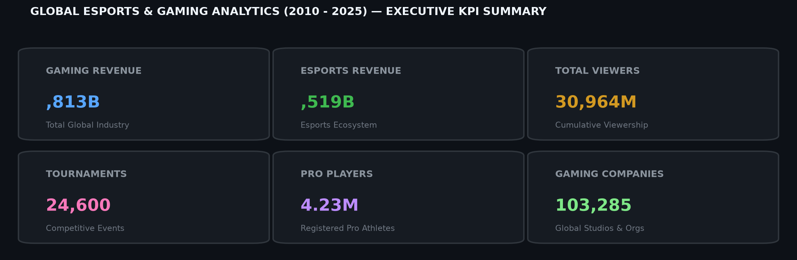
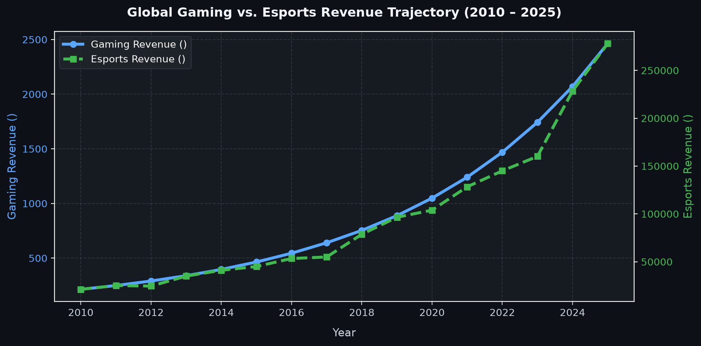
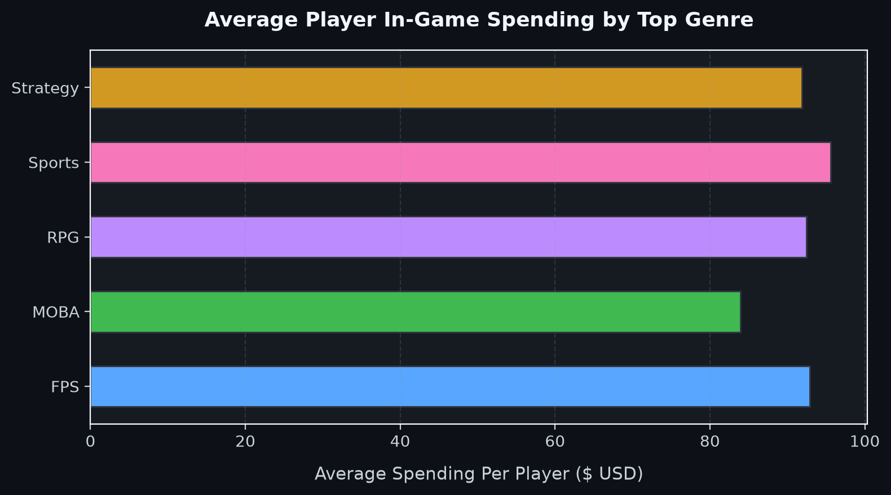

# 🎮 Global Esports & Gaming Revenue Analytics (2010 – 2025)

[](https://www.microsoft.com/en-us/microsoft-365/excel)
[](./data/esports_gaming_dataset.csv)
[](#)

> **Author:** Krishna Makwana  
> **Domain:** Gaming Industry & Esports Market Intelligence  
> **Mentor / Guided By:** Rahul Gupta Sir  
> **Tools Used:** Microsoft Excel (Advanced Formulas, Pivot Tables, Pivot Charts, Slicers, Data Modeling, Dashboard Design)

---

## 📌 Executive Summary

The global gaming and esports industry has experienced exponential expansion between **2010 and 2025**, transitioning from a niche entertainment sector into a multi-trillion-dollar global entertainment powerhouse. 

This project delivers an end-to-end data analytics study and interactive dashboard built in **Microsoft Excel**. It evaluates historical performance, player demographics, regional dominance, monetization strategies across genres, viewership trajectories, and female gamer participation trends across **25 countries** and **7 global regions**.

---

## 📊 Executive KPI Summary



| Key Performance Indicator | Metric Value | Business Context |
| :--- | :--- | :--- |
| **Total Global Gaming Revenue** | **$14,813 Billion ($14.8T)** | Cumulative global revenue across console, PC, and mobile gaming |
| **Total Esports Revenue** | **$1,519 Billion ($1.5T)** | Direct esports revenue stream (sponsorships, media rights, prize pools) |
| **Total Esports Viewership** | **30,964 Million (30.9B)** | Cumulative global live stream & tournament audience impressions |
| **Esports Tournaments Organized** | **24,600 Tournaments** | Competitive professional and regional tournaments conducted |
| **Professional Esports Players** | **4,231,488 Players** | Registered professional competitive players globally |
| **Registered Gaming Companies** | **103,285 Studios/Orgs** | Game publishers, developers, and esports organizational entities |

---

## 🎯 Project Objectives

1. **Tournaments & Ecosystem Scale:** Quantify the total volume of competitive esports tournaments organized globally (2010–2025).
2. **Industry Infrastructure:** Measure the total number of registered gaming studios and publishers.
3. **Athletic Talent Pool:** Analyze the growth and distribution of registered professional esports players.
4. **Audience Reach:** Visualize cumulative viewership demand across streaming and broadcast platforms.
5. **Genre Monetization:** Determine average in-game player spending across top gaming genres (*FPS, MOBA, RPG, Sports, Strategy*).
6. **Platform & Regional Dominance:** Identify which countries and regions lead in active player bases across *PC, Console, and Mobile*.
7. **Diversity & Inclusivity:** Track the growth trajectory of female gamer participation rates across regions.
8. **Viewership Trends:** Analyze platform-wise audience distribution (*Mobile vs. Console vs. PC*).
9. **Financial Correlation:** Evaluate the revenue generated by core gaming vs. direct esports monetization over a 16-year timeline.

---

## 📈 Visual Insights & Key Trends

### 1. Revenue Growth Trajectory (2010 – 2025)


- **Continuous Compound Growth:** Gaming revenue expanded from under $214B in 2010 to over $1,742B annually by 2023–2025.
- **Esports Multiplier:** Direct esports monetization followed a steep growth curve, driven by streaming rights, brand sponsorships, and multi-million-dollar prize pools.

---

### 2. Player Spending by Game Genre


- **Sports Titles:** Lead player spending in **Africa (49%)**, **North America (35%)**, and **South America (32%)**, fueled by recurring franchise releases and microtransactions.
- **RPGs & MMORPGs:** Drive the highest average spending in the **Middle East (28%)** and **Europe (27%)**.
- **FPS (First-Person Shooters):** Dominates expenditure in **Oceania (39%)**.
- **Strategy Games:** Capture the highest spending share in **Asia (23%)**.

---

## 🔍 In-Depth Analytical Findings

### 🖥️ 1. Active Players by Platform Leaders
- **Console Gaming:** **Saudi Arabia (362.7M)** leads in active player density on console hardware.
- **Mobile Gaming:** **India (281.3M)** dominates mobile gaming adoption due to affordable smartphone penetration and mobile-first competitive titles.
- **PC Gaming:** **South Africa (321.7M)** records the highest active player base on the PC platform.

### 👩‍💻 2. Female Gamer Participation
- Between 2010 and 2025, female gaming participation grew consistently across every global region.
- **Europe** achieved the highest regional participation rate, demonstrating sustained growth in both casual gaming and competitive grassroots esports.

### 📺 3. Global Viewership & Streaming Reach
- **Leading Region:** **Europe** recorded the highest viewership globally with **913M** total viewers.
- **Platform Viewership Split:**
  - 📱 **Mobile:** **554 Million Viewers** *(Highest platform share)*
  - 🎮 **Console:** **513 Million Viewers**
  - 💻 **PC:** **382 Million Viewers**

### 💰 4. Global Market Leaders & Monetization Peaks
- **Global Leaders:** **Europe** ($987B Gaming / $102B Esports) and **Asia** ($614B Gaming / $79B Esports) dominate total monetization in 2025.
- **Mid-Tier Strongholds:** **North America** ($388.53B Gaming / $44B Esports) and **South America** ($280.94B Gaming / $33B Esports).
- **Emerging Markets:** The **Middle East** demonstrated massive growth, generating **$90.08B** in Gaming revenue and **$11B** in Esports revenue.
- **Early Peak Regions (2024):** **Africa** ($76.39B) and **Oceania** ($14.1B) achieved peak financial performance in 2024.

---

## 💡 Strategic Business Recommendations

1. **Mobile-First Emerging Market Expansion:** Prioritize mobile esports tournaments and localized monetization in high-growth regions like India and Southeast Asia where mobile accounts for >55% of all viewership.
2. **Genre-Targeted In-Game Offerings:** Tailor in-game purchase mechanics to regional genre preferences (e.g., sports microtransactions in North/South America, battle-pass RPG mechanics in Europe and the Middle East).
3. **Inclusive Community & Grassroots Tournaments:** Expand female-focused competitive circuits and collegiate leagues, building upon the consistent multi-year growth in female participation.
4. **Latency & Infrastructure Optimization:** Invest in regional server infrastructure in emerging PC and Console hubs to decrease average latency and boost player retention.

---

## 📁 Repository Structure

```text
├── 📊 Krishna_Makwana_Esports_Analysis.xlsx   # Full interactive Excel workbook
├── 📁 data/
│   └── esports_gaming_dataset.csv            # Cleaned 400-row tabular dataset
├── 📁 images/                                 # Visualizations, KPI cards & charts
│   ├── kpi_summary_cards.png
│   ├── revenue_growth_trend.png
│   └── genre_spending_analysis.png
├── 📁 reports/                                # Documentation and executive notes
├── 📄 .gitignore                             # Git ignore rules for Excel temporary files
└── 📄 README.md                              # Project documentation & analysis report
```

---

## 📋 Data Dictionary

| Column Name | Data Type | Description |
| :--- | :--- | :--- |
| `Year` | Integer | Observation year (2010 – 2025) |
| `Country` | Text | Name of the analyzed country (25 countries) |
| `Region` | Text | Geographic region (Asia, Europe, North America, etc.) |
| `Gaming_Revenue` | Numeric | Total gaming revenue generated ($ Billion USD) |
| `Esports_Revenue` | Numeric | Esports-specific revenue stream ($ Million USD) |
| `Active_Players` | Numeric | Estimated active player count (in Millions) |
| `Esports_Viewers_Million` | Numeric | Viewership reach (in Millions) |
| `Avg_Spending` | Numeric | Average annual spend per player ($ USD) |
| `Top_Genre` | Text | Top-performing game genre (FPS, MOBA, RPG, Sports, Strategy) |
| `Top_Platform` | Text | Primary gaming hardware (Mobile, PC, Console) |
| `Esports_Tournaments_Count` | Integer | Number of sanctioned tournaments organized |
| `Pro_Players` | Integer | Number of registered professional esports players |
| `Female_Gamer_Percent` | Numeric | Percentage share of female gamers in the market |
| `Gaming_Companies` | Integer | Number of active gaming studios and organizations |

---

## 🚀 How to Open & Explore the Project

1. **Clone or Download the Repository:**
   ```bash
   git clone https://github.com/<YOUR-USERNAME>/<YOUR-REPO-NAME>.git
   ```
2. **Open the Excel Workbook:**
   - Launch [`Krishna_Makwana_Esports_Analysis.xlsx`](./Krishna_Makwana_Esports_Analysis.xlsx) in Microsoft Excel (2016 or newer recommended).
3. **Navigate the Sheets:**
   - 🎯 **Objective:** Core business questions & analytics goals.
   - 🗃️ **Esports dataset:** Full 400-record master database.
   - 📊 **Pivot table:** Structured aggregations and cross-tabulations.
   - 🖥️ **Dashboard:** Dynamic visual interface with interactive slicers.
   - 💡 **Insights:** Detailed regional breakdown and analytical commentary.

---

## 👨‍💻 Author & Acknowledgements

- **Author:** Krishna Makwana
- **Mentorship:** Rahul Gupta Sir
- **Portfolio:** [Krishna-Makwana11](https://github.com/Krishna-Makwana11)
